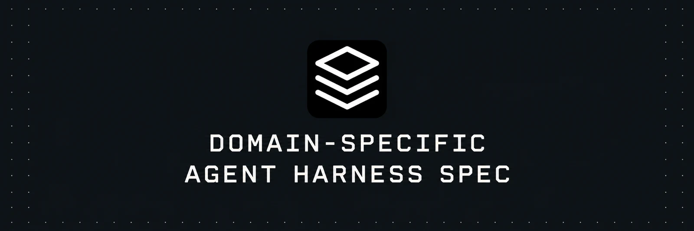

<p align="center">
  <a href="https://gabriel-operator.github.io/domain-specific-agent-harness-spec/">
    
  </a>
</p>

<p align="center">
  <strong>An open specification for giving agent harnesses a domain, teams, and playbooks.</strong><br>
  Versioned personas · Model and tool binding · Human review
</p>

<p align="center">
  <a href="https://gabriel-operator.github.io/domain-specific-agent-harness-spec/">Docs</a> ·
  <a href="#quickstart">Quickstart</a> ·
  <a href="https://gabriel-operator.github.io/domain-specific-agent-harness-spec/specification/">Specification</a> ·
  <a href="https://gabriel-operator.github.io/domain-specific-agent-harness-spec/examples/">Examples</a> ·
  <a href="https://gabriel-operator.github.io/domain-specific-agent-harness-spec/llms.txt">llms.txt</a>
</p>

<p align="center"><strong>Draft 0.1</strong> · <a href="LICENSE">Apache 2.0</a></p>

---

A **persona** is a versioned Git definition of a domain, its teams, and the playbooks they use. It also carries shared data definitions, rules, and evals. The **runtime** verifies those definitions and binds workspace resources. The **agent harness** runs the agent loop and coordinates model calls and tool use.

## Quickstart

1. **Inspect an example persona.** Meeting desk includes an ontology, a Studio team, a calendar connector requirement, and playbooks for drafting and publishing a meeting summary. [Meeting desk files](public/examples/meeting-desk)
2. **Follow a team goal.** Load the persona, bind a workspace calendar, then review and publish a summary through the team’s playbooks. [Implementation walkthrough](https://gabriel-operator.github.io/domain-specific-agent-harness-spec/implementation/#bind-and-run-a-team-goal)
3. **Check the rules.** Use the specification for the folder layout, resource keys, registry pins, and runtime requirements. [Specification](https://gabriel-operator.github.io/domain-specific-agent-harness-spec/specification/)

## Architecture


## How it works

1. **Map the organization’s apps.** With a domain specialist, inventory the apps people use, which records they own, and how the team can read or update them.
2. **Define the ontology.** Give those records shared entity names, fields, and relationships. Map data from the source apps to the persona’s versioned definitions.
3. **Compose teams from playbooks.** Each playbook declares its inputs, outputs, connector operations, and approval rules. Teams group compatible playbooks around the work they do.
4. **Run a team goal.** The goal selects and invokes the playbooks it needs. The runtime binds workspace resources, and the harness selects compatible models for text, speech, or vision and runs the agents. Connectors use accounts whose credentials are stored in the vault. Custom apps can display mapped data and agent results.
5. **Rehearse, approve, and execute.** A person resolves decisions that need judgment. For a protected action, the harness can rehearse the playbook’s proposed change in a sandbox. The domain specialist reviews the rehearsal and approves the exact action before it reaches the live connector. The harness records the receipt after execution. Decisions and outcomes inform reviewed revisions to playbooks, mappings, and evals. [Governed execution](https://gabriel-operator.github.io/domain-specific-agent-harness-spec/concepts/governed-execution/)
6. **Share and recombine.** In the proposed marketplace, teams can mix and match playbook packages to build different personas. Authors can also list complete personas for others to adopt.

[Follow the illustrated walkthrough](https://gabriel-operator.github.io/domain-specific-agent-harness-spec/#why-a-domain-specific-harness).

## Persona, runtime, harness

| Term | What it means |
| --- | --- |
| **Persona** | The Git definition of a domain model, its teams, and the playbooks they use. |
| **Playbook** | A reusable workflow with declared inputs, outputs, operations, and approval rules. |
| **Goal** | A desired outcome within a team that can invoke one or more playbooks. |
| **Runtime** | Loads and verifies a persona, connects workspace resources, and coordinates execution. |
| **Harness** | Runs the agent loop and coordinates model calls and tool use. |
| **Agent** | A worker that uses instructions and tools. A team can include several agents. |
| **Workspace** | One installation's accounts, records, permissions, and run history. |

The root [`SKILL.md`](https://agentskills.io/specification) follows Agent Skills. A persona adds declarative definitions and a registry of pinned resources. This draft covers persona import and runtime behavior, including reporting which steps can run. How a runtime connects to its harness depends on the implementation.

Existing paths and identifiers such as `assets/persona-evals.json` and `teams[].bots` still apply.

## What a persona contains

```text
persona-lane/
├── SKILL.md
├── assets/
│   ├── chat-config.json
│   ├── chat-app.json
│   ├── ontology.json
│   ├── persona-evals.json
│   ├── studio-teams.json
│   └── data-feeds/
├── references/
│   ├── registry.json
│   ├── workspace.json
│   ├── lists/
│   ├── pipelines/
│   └── workflows/
└── skills/
```

The [folder reference](https://gabriel-operator.github.io/domain-specific-agent-harness-spec/specification/#1-folder-structure-) explains which files each profile uses and which resources belong to the workspace. The [implementation guide](src/content/docs/implementation.mdx) maps the architecture to the files and includes example JSON.

The draft marks features **Extracted** (used in Gabriel today), **Proposed** (new in this draft), or **Planned** (still to be specified). The core format and registry are extracted. Runtime binding and presence are proposed. A complete set of interoperable schemas and a shared team orchestration contract are planned.

## Read the docs

| Page | Start here for |
| --- | --- |
| [Specification](src/content/docs/specification.mdx) | Folder layout, stable keys, registry, definition files, and runtime rules |
| [Implementation guide](src/content/docs/implementation.mdx) | Architecture-to-file map, example JSON, and runtime binding |
| [Apps and connectors](src/content/docs/apps.mdx) | Connector operations, shared records, app packages, and live sync |
| [Concept reference](src/content/docs/concepts/index.mdx) | Personas, teams, goals, connectors, apps, and runtime behavior |
| [Skill catalogue](src/content/docs/skills.mdx) | Gabriel Operator authoring skills and individual action, node, and component references |
| [Examples](src/content/docs/examples.mdx) | The Lane Studio tour and 17 persona architectures |
| [Terms and standards](src/content/docs/standards.mdx) | Vocabulary and how Agent Skills, MCP, A2A, and Standard Agents fit |

The format comes from [Gabriel Operator](https://github.com/Gabriel-Operator). The [Portable Persona Runtime installer](https://github.com/Gabriel-Operator/portable-persona-runtime) deploys published personas to a self-hosted runtime appliance. Check the runtime's capability report for the steps it can execute, especially offline.

For a coding agent, start with:

```text
Read https://gabriel-operator.github.io/domain-specific-agent-harness-spec/llms.txt before authoring a persona or implementing a runtime.
```

## Develop locally

Requires Node.js 22.23 or later.

```sh
npm ci
npm run dev -- --background
npm run build
```

The site uses Astro and Starlight. Pages live in `src/content/docs/`, diagrams in `src/components/`, and styles in `src/styles/`. The build writes `dist/`. The GitHub Pages workflow sets `SITE_BASE=/domain-specific-agent-harness-spec`. [`public/llms.txt`](public/llms.txt) indexes the source for coding agents.

See [Contributing](CONTRIBUTING.md) to report an issue or propose a change. Released under the [Apache License 2.0](LICENSE).
